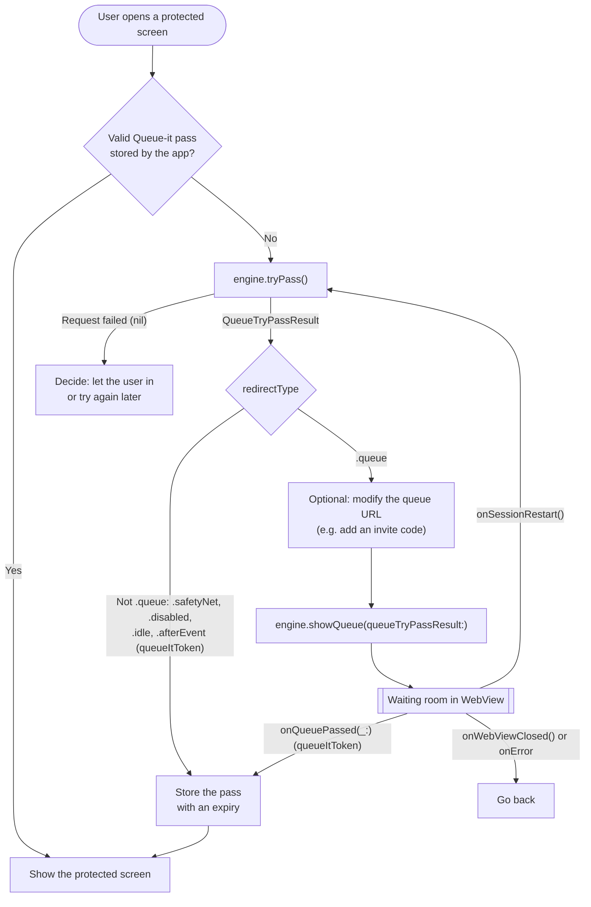
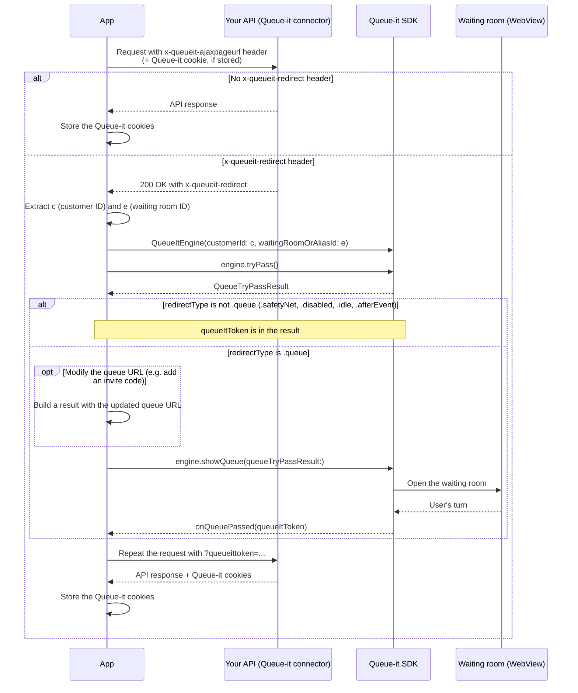

# Queue-it iOS Swift SDK

Library for integrating Queue-it's virtual waiting room into an iOS app written in Swift.

Before starting please download the whitepaper "Mobile App Integration" from GO Queue-it Platform. This whitepaper contains the needed information to perform a successful integration.

## Requirements

*   iOS 15.0+
*   Swift 5.0+
*   Xcode 13.0+

## Installation

### Using Swift Package Manager

In Xcode:

1. Open your project
2. Navigate to `File > Add Packages...`
3. Enter the repository URL:
   ```
   https://github.com/queueit/ios-swift-sdk
   ```
4. Select the version (e.g., `1.0.0`)
5. Click `Add Package`

### Using `Package.swift`:
If you're building a Swift package, add QueueItKit as a dependency:

```swift
dependencies: [
    .package(url: "https://github.com/queueit/ios-swift-sdk", from: "1.1.0")
]
```

Then add it to your target:

```swift
targets: [
    .target(
        name: "YourTarget",
        dependencies: ["QueueItKit"]
    )
]
```

### Using XCFramework (Binary)

Download pre-compiled XCFramework binaries from [GitHub Releases](https://github.com/queueit/ios-swift-sdk/releases).

1. Download the latest `QueueItKit.xcframework.zip` from releases
2. Extract and drag `QueueItKit.xcframework` into your Xcode project
3. Select your target → General → Frameworks, Libraries, and Embedded Content
4. Ensure `QueueItKit.xcframework` is set to "Embed & Sign"

## How to use the library

As the App developer, you must manage the state (whether the user was previously queued up or not) inside the app's storage.

After you have received the `onQueuePassed` callback, the app must remember to keep the state, possibly with a date/time expiration. When the user wants to navigate to specific screens on the app which needs Queue-it protection, your code checks this state/variable, and only call SDK methods in the case where the user did not previously queue up.

Please note that when the user clicks back to navigate back to a protected screen, the same check needs to be done.

### QueueListener

QueueListener is the primary callback interface used by QueueItKit to notify your app about key events during the queue lifecycle.

Your ViewModel, ViewController, or Coordinator should conform to this protocol to respond to queue state changes, errors, and WebView events.

#### Purpose
QueueListener enables your application to:

* Respond when the user successfully passes the queue
* Detect when the queue WebView is about to open
* Handle situations where the queue is disabled or unavailable
* Receive errors from the Queue‑it engine
* Optionally react to WebView closure, session restarts, URL changes, and SSL errors

#### Required Methods
* onQueuePassed(_:) - Called when the user has successfully passed the queue. Use this to retrieve and store the queueItToken.
* onQueueViewWillOpen() - Triggered just before the queue WebView opens.
* onQueueDisabled(_:) - Indicates that the queue is in 'disabled' state. Not raised on the `tryPass()` + `showQueue(queueTryPassResult:)` path: a disabled, idle or after-event waiting room is returned by `tryPass()` with a `queueItToken`, and `showQueue(queueTryPassResult:)` reports it through `onQueuePassed(_:)`. Check the result's `redirectType` if you need to tell them apart.
* onQueueItUnavailable() - Called when Queue‑it services cannot be reached.
* onError(_:errorMessage:) - Called when the SDK encounters errors (e.g., network issues or invalid configs).

#### Optional Methods
These include built‑in default empty implementations:

* onWebViewClosed() — Called when user closes WebView with close link (queueit://close)
* onSessionRestart() — Queue-it restarted the session
* onQueueUrlChanged(_ url:) — Useful for logging or analytics
* onSSLError(_ errorMessage:) — Called when the SDK encounters SSL issues inside WebView

### Initialize QueueItEngine

```swift
QueueItEngine(
    customerId: String,
    waitingRoomOrAliasId: String,
    queueListener: QueueItKit.QueueListener,
    themeName: String? = nil,
    language: String? = nil,
    options: QueueItKit.QueueItEngineOptions? = nil,
    webView: WKWebView? = nil,
    waitingRoomDomain: String? = nil,
    queuePathPrefix: String? = nil
)
```

#### QueueItEngine Parameters

| Parameter         | Required (Default value)             | Description                                                                                                                                                                                   |
| ----------------- | ------------------------------------ | --------------------------------------------------------------------------------------------------------------------------------------------------------------------------------------------- |
| customerId        | Yes                                  | Your customer ID                                                                                                                                                                              |
| waitingRoomOrAliasId    | Yes                                  | ID of the waiting room or alias                                                                                                                                                               |
| queueListener     | Yes                                  | Object implementing `QueueListener` to handle callbacks                                                                                                                                       |
| themeName        | No (Waiting Room's default theme)    | Custom Theme name to use for the waiting room. If omitted, the Waiting Room's default theme will be used                                                                                           |
| language          | No (Waiting Room's default language) | Language ID to use for the waiting room. If omitted, the Waiting Room's default language will be used                                                                                         |
| options           | No (default options)                 | Configuration for `QueueItEngineOptions`: `webViewUserAgent` (custom user agent string) and `viewDelayMs` (delay in milliseconds before showing WebView)                                      |
| webView           | No (SDK creates one)                 | Provide a custom `WKWebView` instance if you need advanced control                                                                                                                            |
| waitingRoomDomain | No (`{customerId}.queue-it.net`)     | Custom Waiting Room domain to use for the requests from Mobile to Queue-it. Can be a Proxy Domain, if you are running Queue-it Behind Proxy                                                   |
| queuePathPrefix   | No (none)                            | Queue Path Prefix to use, if you are running Waiting Room on same domain as your normal website. Requires `waitingRoomDomain` to also be provided. If not, then this parameter will be ignored |

#### Using Custom WKWebView
```swift
let webView = WKWebView()
engine = QueueItEngine(
    customerId: customerId, 
    waitingRoomOrAliasId: waitingRoomOrAliasId, 
    queueListener: self, 
    webView: webView
)
```

#### Use options to set custom user agent and webView delay.
```swift
var options = QueueItEngineOptions()
options.webViewUserAgent = "CustomUserAgent/1.0"
options.viewDelayMs = 1000

QueueItEngine(
    customerId: customerId, 
    waitingRoomOrAliasId: waitingRoomOrAliasId, 
    queueListener: queueListener, 
    options: options
)
```

#### Example of building an engine (SwiftUI)
```swift
class MyAppViewModel: ObservableObject, QueueListener {
    private(set) var engine: QueueItEngine?
    @Published var manager: QueueItViewManager?

    @Published var showWebView: Bool = false

    private var cancellables = Set<AnyCancellable>()

    @MainActor private func createEngine() {            
        engine = QueueItEngine(customerId: customerId, waitingRoomOrAliasId: waitingRoomOrAliasId, queueListener: self, themeName: themeName, language: language)
        manager = engine?.viewManager
        
        cancellables.removeAll()
        manager?.$showWebView
            .receive(on: RunLoop.main)
            .assign(to: \.showWebView, on: self)
            .store(in: &cancellables)
    }

    func onQueuePassed(_ queuePassedInfo: QueuePassedInfo) {
        let token = queuePassedInfo.queueItToken
        Task { @MainActor in self.manager?.hideQueue() }
    }

    func onQueueViewWillOpen() { /* Show loading indicator */ }
    func onQueueDisabled(_ queueDisabledInfo: QueueDisabledInfo) { /* Handle queue disabled */ }
    func onQueueItUnavailable() { /* Handle queue service unavailable */ }
    func onError(_ error: QueueError, errorMessage: String) { /* Handle queue errors */ }
    func onWebViewClosed() { /* User closed queue UI */ }
}
```

#### Example of building an engine (UIKit)
`WebViewControlDelegate` is a protocol in your app (not part of QueueItKit) that your view controller implements to present and dismiss the WebView:
```swift
@MainActor protocol WebViewControlDelegate: AnyObject {
    func presentWebView()
    func dismissWebView()
}

class MyAppViewModel: ObservableObject, QueueListener {

    var engine: QueueItEngine?
    var manager: QueueItViewManager?
    weak var delegate: WebViewControlDelegate?
    
    private var cancellables = Set<AnyCancellable>()
    
    @MainActor private func createEngine() {
        engine = QueueItEngine(customerId: customerId, waitingRoomOrAliasId: waitingRoomOrAliasId, queueListener: self, themeName: themeName, language: language)
        manager = engine?.viewManager
        
        cancellables.removeAll()
        manager?.$showWebView
            .receive(on: RunLoop.main)
            .sink { [weak self] newValue in
                if newValue {
                    self?.delegate?.presentWebView()
                } else {
                    self?.delegate?.dismissWebView()
                }
            }
            .store(in: &cancellables)
    }
    
    func onQueuePassed(_ queuePassedInfo: QueuePassedInfo) {
        let token = queuePassedInfo.queueItToken
        Task { @MainActor in self.manager?.hideQueue() }
    }

    func onQueueViewWillOpen() { /* Show loading indicator */ }
    func onQueueDisabled(_ queueDisabledInfo: QueueDisabledInfo) { /* Handle queue disabled */ }
    func onQueueItUnavailable() { /* Handle queue service unavailable */ }
    func onError(_ error: QueueError, errorMessage: String) { /* Handle queue errors */ }
    func onWebViewClosed() { /* User closed queue UI */ }
}
```

### Integration flow: tryPass() and showQueue()

The integration has two steps:

1.  `tryPass()` asks Queue-it for the status of the waiting room and returns a `QueueTryPassResult`, without showing any UI.
2.  If the result's `redirectType` is `.queue`, call `showQueue(queueTryPassResult:)` to present the waiting room in the WebView. When it is the visitor's turn, `onQueuePassed(_:)` is called with the `queueItToken`.

Because these are two separate calls, your app decides in which layer each step happens, and can change the queue URL before the waiting room is shown (see [Modify the queue URL before showing the waiting room](#modify-the-queue-url-before-showing-the-waiting-room)).



#### tryPass()

`tryPass` has three variants: no arguments, with an enqueue token (`tryPass(enqueueToken:)`), or with an enqueue key (`tryPass(enqueueKey:)`). It returns `nil` if the request fails. The SDK has then called `onError(_:errorMessage:)` (e.g. no connection) or `onQueueItUnavailable()` on your `QueueListener`. No callback is made if another `tryPass()` request is already in progress.

```swift
@MainActor func enterProtectedArea() {
    createEngine()
    Task {
        let result: QueueTryPassResult?
        if !enqueueToken.isEmpty {
            result = await engine?.tryPass(enqueueToken: enqueueToken)
        } else if !enqueueKey.isEmpty {
            result = await engine?.tryPass(enqueueKey: enqueueKey)
        } else {
            result = await engine?.tryPass()
        }
        guard let result else { return } // Request failed: see onError / onQueueItUnavailable

        switch result.redirectType {
        case .queue:
            showQueue(result)
        case .disabled, .idle, .afterEvent:
            // Waiting room not active: continue (result.queueItToken is set)
            break
        default:
            // Passed through (e.g. safety net): store result.queueItToken and continue
            break
        }
    }
}
```

#### showQueue()

```swift
@MainActor func showQueue(_ result: QueueTryPassResult) {
    engine?.showQueue(queueTryPassResult: result)
}
```

`showQueue(queueTryPassResult:)` only opens the WebView when the result's `redirectType` is `.queue` and it has a `queueUrl`. For any other result it does not show the waiting room: if the result carries a `queueItToken` (`isPassedThrough`), it calls `onQueuePassed(_:)`. This includes disabled, idle and after-event waiting rooms, so check the result's `redirectType` if you need to tell them apart.

### Modify the queue URL before showing the waiting room

Between `tryPass()` and `showQueue(queueTryPassResult:)` you can change the queue URL that the WebView loads, for example to add an invite-only `code` or other query parameters.

`QueueTryPassResult` is read-only, so build a new result with the same values and the updated `queueUrl`, and pass that to `showQueue(queueTryPassResult:)`. The SDK loads the URL as given.

```swift
func addingQueryItems(_ items: [URLQueryItem], to result: QueueTryPassResult) -> QueueTryPassResult {
    guard let queueUrl = result.queueUrl,
          var components = URLComponents(string: queueUrl) else { return result }
    components.queryItems = (components.queryItems ?? []) + items

    return QueueTryPassResult(
        queueItToken: result.queueItToken,
        queueUrl: components.string,
        targetUrl: result.targetUrl,
        isPassedThrough: result.isPassedThrough,
        redirectType: result.redirectType,
        urlTTLInMinutes: result.urlTTLInMinutes
    )
}

// After tryPass(), e.g. to add an invite code received after the check:
if result.redirectType == .queue {
    let updated = addingQueryItems([URLQueryItem(name: "code", value: inviteCode)], to: result)
    engine?.showQueue(queueTryPassResult: updated)
}
```

> **Note:** Only add or change query parameters, and keep the existing ones (the SDK adds its own). Do not change the scheme, host or path: the SDK uses the queue URL's host (and, behind your CDN, `queuePathPrefix`) to decide which navigations stay in the WebView.

For invite codes, `setInviteCode(_:)` is the built-in option (see [Invite-only waiting rooms](#invite-only-waiting-rooms)): the SDK adds the `code` parameter to the queue URL returned by `tryPass()`. Modify the URL yourself only when you need other changes, or when the code is only known after `tryPass()` has returned. Don't add a `code` parameter yourself if you have already called `setInviteCode(_:)`.

### Invite-only waiting rooms

If your waiting room is configured as invite-only, visitors need to present an invite code (the `code` query parameter on the waiting-room URL). Pass that code to the engine before calling `tryPass()`, and the SDK will append it to the queue URL in the result:

```swift
await engine?.setInviteCode("<your-invite-code>")
let result = await engine?.tryPass()
```

`setInviteCode` accepts `String?`; passing `nil` or an empty string clears any previously-set code.

#### Capturing the invite code from a deep link

Capturing the code from the link your user opened (Universal Link, custom URL scheme, push payload, manually pasted text, etc.) is the app's responsibility — the SDK only consumes the resulting string. A minimal Universal Link example:

```swift
.onOpenURL { url in
    if let code = URLComponents(url: url, resolvingAgainstBaseURL: false)?
        .queryItems?
        .first(where: { $0.name == "code" })?
        .value,
       !code.isEmpty {
        Task { await viewModel.engine?.setInviteCode(code) }
    }
}
```

### Debugging with QueueItLogger

QueueItLogger provides logging capabilities to help you debug integration issues.

#### Enable Debug Logging
```swift
QueueItLogger.setLogLevel(.debug)
```

Available log levels:

* debug
* info
* warn
* error
* fatal

Use .debug during development to see detailed logs about the behavior.

## Queue-it Behind Your CDN (Bring Your Own CDN)

If you are running Queue-it behind your own reverse proxy or CDN, the Mobile Integration can also be setup to run behind your proxy.

To do this, simply use your Proxy Domain as the `waitingRoomDomain` parameter when creating the `QueueItEngine`. If you are running the Queue-it Waiting Room on the same domain as your normal website, you should also provide the `queuePathPrefix` parameter.

### Example with Custom Domain

```swift
engine = QueueItEngine(
    customerId: "yourCustomerId",
    waitingRoomOrAliasId: "yourWaitingRoomId",
    queueListener: self,
    waitingRoomDomain: "queue.yourdomain.com"
)
```

### Example with Custom Domain and Path Prefix

If your waiting room is hosted at `https://yourdomain.com/queue/...`:

```swift
engine = QueueItEngine(
    customerId: "yourCustomerId",
    waitingRoomOrAliasId: "yourWaitingRoomId",
    queueListener: self,
    waitingRoomDomain: "yourdomain.com",
    queuePathPrefix: "queue"
)
```

> **Note:** The `queuePathPrefix` parameter requires `waitingRoomDomain` to also be provided. If `waitingRoomDomain` is not set, the `queuePathPrefix` parameter will be ignored.

## Initialize and Integrate (SwiftUI)

1.  The core logic for interacting with Queue-it is typically handled by a `ViewModel`.

    ```swift
    import SwiftUI
    import Combine
    import QueueItKit

    class MyAppViewModel: ObservableObject, QueueListener {
        private(set) var engine: QueueItEngine?
        @Published var manager: QueueItViewManager?

        @Published var showWebView: Bool = false // Controls SwiftUI WKWebView presentation

        private var cancellables = Set<AnyCancellable>()

        init() {
           QueueItLogger.setLogLevel(.debug)
        }

        @MainActor private func createEngine() {            
            engine = QueueItEngine(customerId: customerId, waitingRoomOrAliasId: waitingRoomOrAliasId, queueListener: self, themeName: themeName, language: language)
            manager = engine?.viewManager
            
            cancellables.removeAll()
            manager?.$showWebView
                .receive(on: RunLoop.main)
                .assign(to: \.showWebView, on: self)
                .store(in: &cancellables)
        }
        
        // 1. Check the waiting room status. 2. Show the waiting room if needed.
        @MainActor func enterProtectedArea() {
            createEngine()
            Task {
                let result: QueueTryPassResult?
                if !enqueueToken.isEmpty {
                    result = await engine?.tryPass(enqueueToken: enqueueToken)
                } else if !enqueueKey.isEmpty {
                    result = await engine?.tryPass(enqueueKey: enqueueKey)
                } else {
                    result = await engine?.tryPass()
                }
                guard let result else { return } // Request failed: see onError / onQueueItUnavailable

                // Shows the waiting room when redirectType is .queue; otherwise calls
                // onQueuePassed(_:) when the result has a queueItToken (passed through,
                // or a disabled, idle or after-event waiting room)
                engine?.showQueue(queueTryPassResult: result)
            }
        }

        // MARK: - QueueListener Conformance
        func onQueuePassed(_ queuePassedInfo: QueuePassedInfo) {
            let token = queuePassedInfo.queueItToken
            Task { @MainActor in self.manager?.hideQueue() }
        }

        func onQueueViewWillOpen() { /* Show loading indicator */ }
        func onQueueDisabled(_ queueDisabledInfo: QueueDisabledInfo) { /* Handle queue disabled */ }
        func onQueueItUnavailable() { /* Handle queue service unavailable */ }
        func onError(_ error: QueueError, errorMessage: String) { /* Handle queue errors */ }
        func onWebViewClosed() { /* User closed queue UI */ }
    }
    ```

    `showWebView` is used to notify UI updates
    ```swift
    manager?.$showWebView
        .receive(on: RunLoop.main)
        .assign(to: \.showWebView, on: self)
        .store(in: &cancellables)
    ```

2. Integrate with your SwiftUI View
    ```swift
    import SwiftUI
    import WebKit
    import QueueItKit

    struct MyAppView: View {
        
        @StateObject private var viewModel = MyAppViewModel()

        var body: some View {
            ScrollView {
                if #available(iOS 16.0, *) {
                    content
                        .fullScreenCover(isPresented: $viewModel.showWebView) {
                            if let manager = viewModel.manager {
                                QueueWebViewContainer(viewManager: manager)
                            }
                        }
                } else {
                    content
                        .fullScreenCover(isPresented: $viewModel.showWebView) {
                            if let manager = viewModel.manager {
                                QueueWebViewContainer(viewManager: manager)
                            }
                        }
                }
            }
            .padding()
        }
        
        private var content: some View {
            VStack(spacing: 20) {
                Button("Enter") {
                    viewModel.enterProtectedArea()
                }
            }
        }
    }
    ```

    `QueueWebView` is the SwiftUI view wraps the WKWebView. The color of the loading page can be configured during initialization.
    ```swift
    QueueWebViewContainer(viewManager: manager, progressBackgroundColor: Color, progressColor: Color)
    ```

## Initialize and Integrate (UIKit)

1.  The core logic for interacting with Queue-it is typically handled by a `ViewModel`.

    ```swift
    import Foundation
    import Combine
    import QueueItKit

    // Defined in your app: implemented by the view controller that presents the WebView
    @MainActor protocol WebViewControlDelegate: AnyObject {
        func presentWebView()
        func dismissWebView()
    }

    class MyAppViewModel: ObservableObject, QueueListener {

        var engine: QueueItEngine?
        var manager: QueueItViewManager?
        weak var delegate: WebViewControlDelegate?
        
        private var cancellables = Set<AnyCancellable>()
        
        init() {
            QueueItLogger.setLogLevel(.debug)
        }

        @MainActor private func createEngine() {
            
            engine = QueueItEngine(customerId: customerId, waitingRoomOrAliasId: waitingRoomOrAliasId, queueListener: self, themeName: themeName, language: language)
            manager = engine?.viewManager
            
            cancellables.removeAll()
            manager?.$showWebView
                .receive(on: RunLoop.main)
                .sink { [weak self] newValue in
                    if newValue {
                        self?.delegate?.presentWebView()
                    } else {
                        self?.delegate?.dismissWebView()
                    }
                }
                .store(in: &cancellables)
        }
        
        // 1. Check the waiting room status. 2. Show the waiting room if needed.
        @MainActor func enterProtectedArea() {
            createEngine()
            Task {
                let result: QueueTryPassResult?
                if !enqueueToken.isEmpty {
                    result = await engine?.tryPass(enqueueToken: enqueueToken)
                } else if !enqueueKey.isEmpty {
                    result = await engine?.tryPass(enqueueKey: enqueueKey)
                } else {
                    result = await engine?.tryPass()
                }
                guard let result else { return } // Request failed: see onError / onQueueItUnavailable

                // Shows the waiting room when redirectType is .queue; otherwise calls
                // onQueuePassed(_:) when the result has a queueItToken (passed through,
                // or a disabled, idle or after-event waiting room)
                engine?.showQueue(queueTryPassResult: result)
            }
        }
        
        // MARK: - QueueListener Conformance
        func onQueuePassed(_ queuePassedInfo: QueuePassedInfo) {
            let token = queuePassedInfo.queueItToken
            Task { @MainActor in self.manager?.hideQueue() }
        }

        func onQueueViewWillOpen() { /* Show loading indicator */ }
        func onQueueDisabled(_ queueDisabledInfo: QueueDisabledInfo) { /* Handle queue disabled */ }
        func onQueueItUnavailable() { /* Handle queue service unavailable */ }
        func onError(_ error: QueueError, errorMessage: String) { /* Handle queue errors */ }
        func onWebViewClosed() { /* User closed queue UI */ }
    }
    ```

    present or dismiss WKWebView via delegate when `showWebView` is changed.
    ```swift
    manager?.$showWebView
        .receive(on: RunLoop.main)
        .sink { [weak self] newValue in
            if newValue {
                self?.delegate?.presentWebView()
            } else {
                self?.delegate?.dismissWebView()
            }
        }
        .store(in: &cancellables)
    ```

2. Integrate with your ViewController

    ```swift
    import UIKit
    import Combine
    import WebKit
    import QueueItKit

    class MyAppView: UIViewController, WebViewControlDelegate {
        
        private var presentedWebVC: UIViewController?
        
        private let viewModel = MyAppViewModel()
        private var cancellables = Set<AnyCancellable>()
        
        override func viewDidLoad() {
            super.viewDidLoad()
            viewModel.delegate = self
        }
        
        @IBAction func enter(_ sender: Any) {
            viewModel.enterProtectedArea()
        }
        
        func presentWebView() {
            guard presentedWebVC == nil, let manager = viewModel.manager else { return }
            let webVC = QueueWebViewController(viewManager: manager)
            webVC.modalPresentationStyle = .fullScreen
            presentedWebVC = webVC
            present(webVC, animated: true)
            
        }
        
        func dismissWebView() {
            guard let webVC = presentedWebVC else { return }
            webVC.dismiss(animated: true) {
                self.presentedWebVC = nil
            }
        }
    }
    ```

    `QueueWebViewController` is the ViewController view wraps the WKWebView. The color of the loading page can be configured during initialization.
    ```swift
    QueueWebViewController(viewManager: manager, progressBackgroundColor: UIColor, progressColor: UIColor)
    ```

## Using Queue-it server-side connector (KnownUser) to protect APIs, consumed by mobile app

If you are using Queue-it's server-side connector (KnownUser) to protect your API, you utilize this in your mobile app, to run a hybrid setup.

This greatly increases the protection and prevents visitors from bypassing the client-side Queue-it integration.

The flow in this setup is the following (simplified):
1. Mobile app calls API endpoints and includes the special Queue-it header
   Endpoint is protected by Queue-it connector
2. Queue-it connector has Trigger/Condition setup to match an Integration Action/Rule, with Queue action-type
3. Queue-it connector intercepts the requests to API and immediately responds with another special Queue-it header, containing information needed to show the Waiting Room
4. Mobile app shows the waiting room using the header from the Queue-it server-side connector

### Implementation

To integrate with a protected API we need to handle the validation responses that we may get in case the user should be queued.

All calls to protected APIs need to include the `x-queueit-ajaxpageurl` header with a non-empty value and a Queue-it accepted cookie (if present).
The integration can be described in the following steps:

1. API Request with `x-queueit-ajaxpageurl` *or* Queue-it accepted cookie is made
2. We get a response which may either be the API response or an intercepted response from the Queue-it connector
3. Scenario 1, user should not be queued (response does not have the `x-queueit-redirect` header)
    1. We store the Queue-it cookies from the response, to include in later API calls
4. Scenario 2, user should be queued
    1. If the user should be queued we'll get a `200 Ok` response with a `x-queueit-redirect` header. We need to extract the `c`(Customer ID) and `e` (Waiting Room ID) query string parameters from the `x-queueit-redirect` header and create a `QueueItEngine` with them, then call `tryPass()` and `showQueue(queueTryPassResult:)`, just as you would normally do with the SDK (see [Integration flow](#integration-flow-trypass-and-showqueue))
    2. We wait for the `onQueuePassed` callback and we store the QueueItToken passed to the callback. If the `tryPass()` result's `redirectType` is not `.queue`, the QueueItToken is already in the result's `queueItToken`
    3. We can repeat the API request, this time appending the `queueittoken={QueueItToken}` query string parameter, to prevent the server-side connector from intercepting the call again
    4. We store the Queue-it cookies from the final response, so they can be set in other API calls



### Client-side and server-side mobile integration (hybrid) with Queue-it Bring Your Own CDN

> Note: This only applies if you are using the Mobile SDK as a client-side protection *and* are using server-side protection using the Queue-it KnownUser Connector.

> If you are only using client-side protection, using the Mobile SDK, refer to the [How to use the library](#how-to-use-the-library) section above.

If you are running Queue-it behind your own reverse proxy the Mobile Integration can also be setup to run behind your proxy. For the hybrid setup, your KnownUser connector will also need to run in "Bring Your Own CDN" mode. Please contact Queue-it Support, for any questions the KnownUser Connector Bring Your Own CDN Setup.

#### Setup Mobile SDK with Bring Your Own CDN, with protected API

To do this simply use your Proxy Domain as the `waitingRoomDomain` parameter when creating the `QueueItEngine`, after getting the Queue-it intercepted response back from your API.

If you are running Queue-it Waiting Room on the same domain as your normal website, you also need to provide the `queuePathPrefix` parameter, to ensure your proxy can route the request to Queue-it origin.

This means in above [Implementation](#implementation) section, point 4.1, you must also provide `waitingRoomDomain` and optionally `queuePathPrefix` when creating the `QueueItEngine`, to serve the Waiting Room through your reverse proxy.

## License

MIT License - see LICENSE file for details

## Support

For support, please visit [Queue-it's support portal](https://support.queue-it.com/) or contact support@queue-it.com
